# Security Implementation – MedVault

Team **MedicalVault** · Zojaja Naveed (FA23-BCT-047) · Tayyeba Usman (FA23-BCT-053)

For each mandatory vulnerability this document gives the vulnerable code, the lab-only exploit with evidence, the secure fix, and how the fix was verified.
All exploitation was performed only on our own local instance (`http://localhost:5000` / `127.0.0.1:5000`). Screenshots are in [`docs/screenshots/`](docs/screenshots/).

| ID | Vulnerability | CWE | CVSS v3.1 | CIA impact | Jira | Fix PR |
|---|---|---|---|---|---|---|
| T-01 | Buffer Overflow | CWE-120 | 8.1 | I, A | MV-14 | [#6](https://github.com/Zojaja-Naveed/MedicalVault/pull/6) |
| T-02 | OS Command Injection | CWE-78 | 8.8 | C, I, A | MV-15 | [#7](https://github.com/Zojaja-Naveed/MedicalVault/pull/7) |
| T-03 | IDOR | CWE-639 | 6.5 (env. 8.3) | C | MV-16 | [#7](https://github.com/Zojaja-Naveed/MedicalVault/pull/7) |
| T-04 | CSRF | CWE-352 | 7.1 | C, I | MV-17 | [#7](https://github.com/Zojaja-Naveed/MedicalVault/pull/7) |
| T-05 | Clickjacking | CWE-1021 | 4.3 | I | MV-18 | [#7](https://github.com/Zojaja-Naveed/MedicalVault/pull/7) |

Each fix is also locked in by an automated regression test in `tests/test_security.py` that replays the exploit on every push and pull request.

---

## 1. Buffer Overflow (T-01, CWE-120)

**Vulnerable code** – `native/parser.c` (native C library loaded by Flask through `ctypes`)

```c
typedef struct { char patient[32]; int verified; } ReportHeader;
...
h.verified = (end && strncmp(end + 1, "LABSIGNED", 9) == 0) ? 1 : 0;
memcpy(h.patient, p, n);   /* BUG: n (length of the name) is never compared with 32 */
h.patient[n] = '\0';
```

The patient name from the uploaded file is copied into a 32-byte stack buffer. The `verified` flag is stored directly after the buffer, so bytes beyond 32 overwrite it.

**Exploit (lab only)**

1. The payload file `samples/forged_overflow.lab` has a 36-character name and the signature `NOT-SIGNED`.

   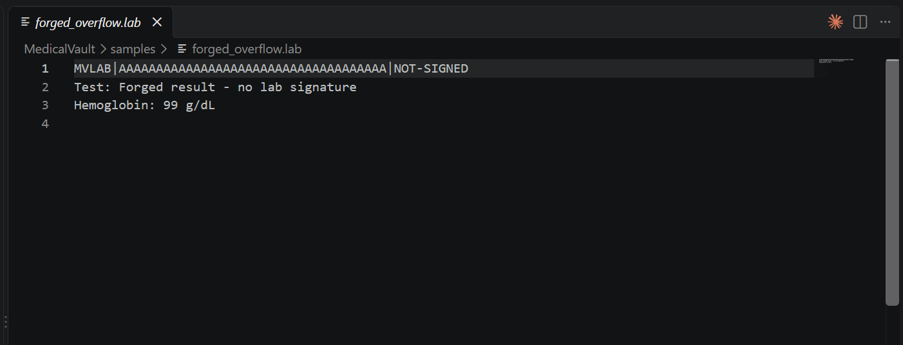

2. Uploading an honest unsigned file shows **Unverified**; uploading the overflow file shows **Lab verified** – the 4 extra bytes overwrote `verified` with a non-zero value.

   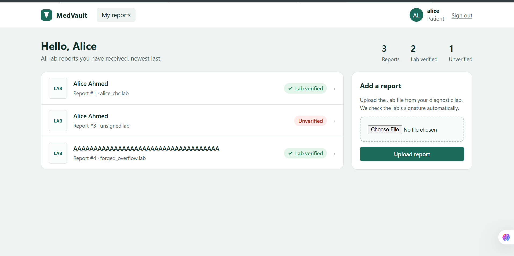

3. The same result from the command-line driver inside the container: a normal unsigned header returns `result=0`, the 36-byte header returns `result=1` (verified).

   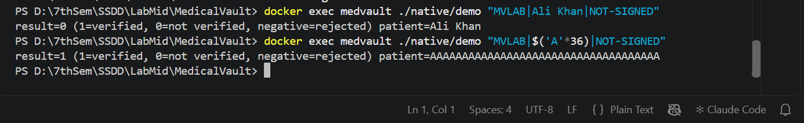

4. **Denial of service:** `samples/crash_overflow.lab` (300-character name) smashes the stack; the server process dies and the browser gets `ERR_EMPTY_RESPONSE`.

   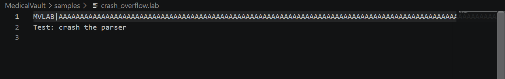
   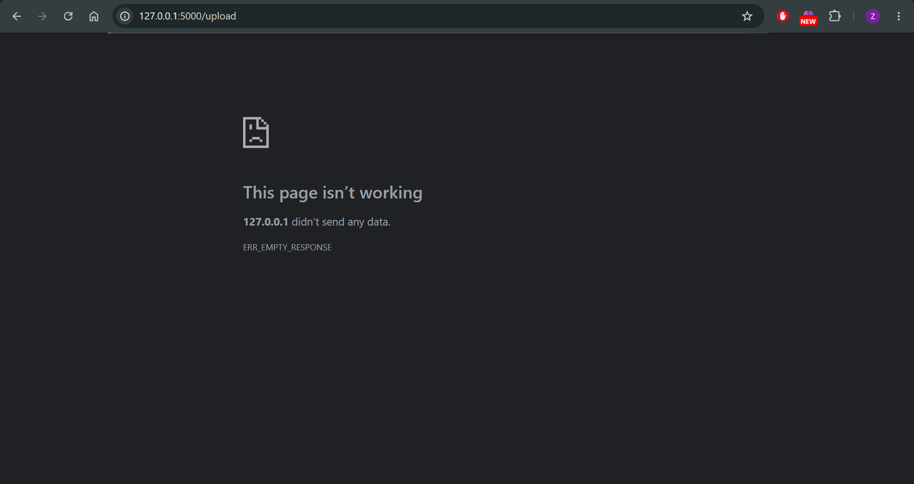

**Fix** – `native/parser.c`

```c
if (strnlen(input, MAX_INPUT) >= MAX_INPUT) return -2;        /* overall length limit   */
...
if (n == 0 || n >= sizeof h.patient) return -2;                /* reject oversize name   */
memcpy(h.patient, p, n);                                       /* safe: n < 32           */
h.patient[n] = '\0';
snprintf(out, out_len, "%s", h.patient);                       /* bounded copy out       */
```

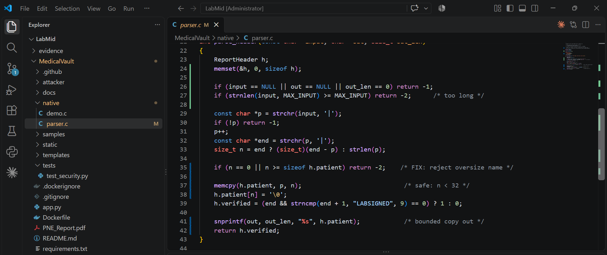

Compiler and runtime mitigations: the library is built with `-fstack-protector-strong -D_FORTIFY_SOURCE=2 -Wl,-z,relro,-z,now` (stack canary, fortified libc calls, full RELRO; ASLR and NX are on by default), and the CI pipeline runs the parser under **AddressSanitizer** with a 300-byte name.

**Verification**

- Uploading the forged file now shows *"Invalid report header"*; no forged row appears and the server keeps running.

  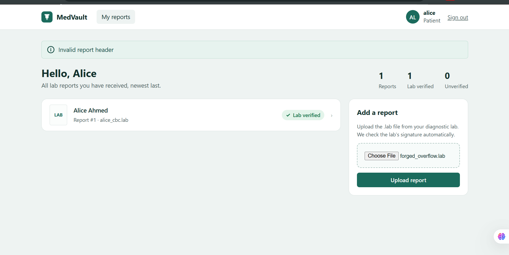

- The CLI driver returns `result=-2` (rejected) for the 36-byte name.

  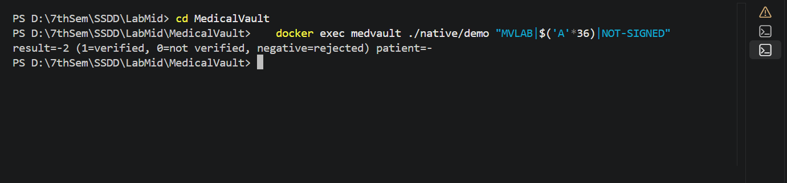

- In the pipeline, the ASAN step that reported `stack-buffer-overflow` before the fix now passes, and `test_overflow_cannot_forge_verified_flag` passes.

  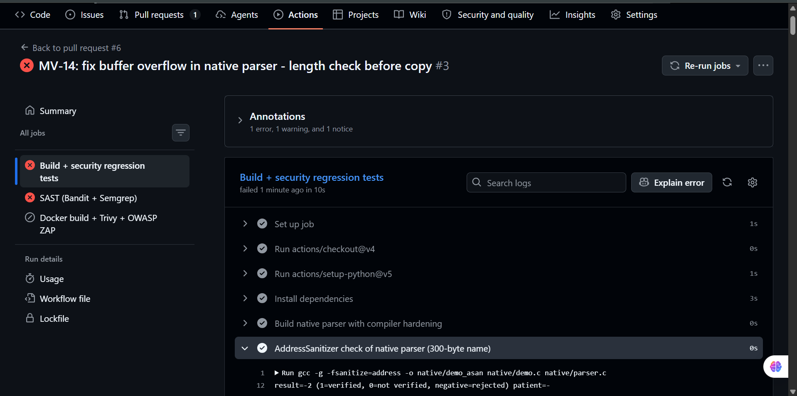

---

## 2. OS Command Injection (T-02, CWE-78)

**Vulnerable code** – `app.py`, `compress_report()`

```python
archive = request.form.get("archive_name", "report")
cmd = f"tar -czf archives/{archive}.tar.gz -C uploads {report['stored_name']}"
subprocess.run(cmd, shell=True, cwd=BASE)
```

**Exploit (lab only)** – as alice, on report 1, enter the file name `x; id > static/leak.txt #` and press **Create .tar.gz**. The `;` ends the `tar` command, `id` runs as a second command and `#` comments out the rest.

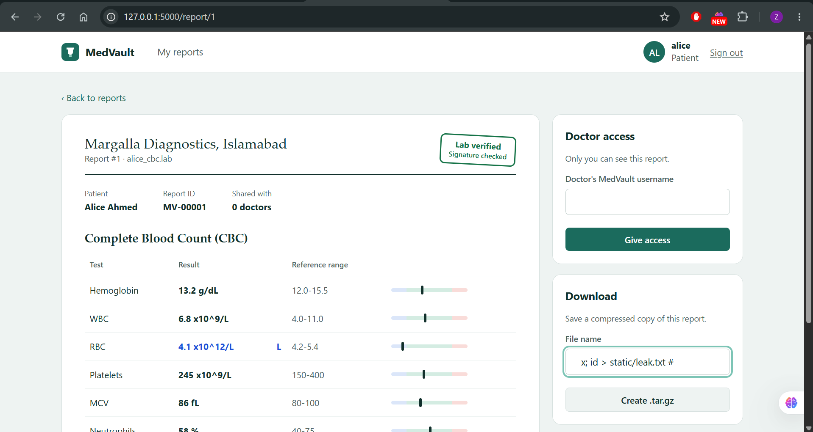
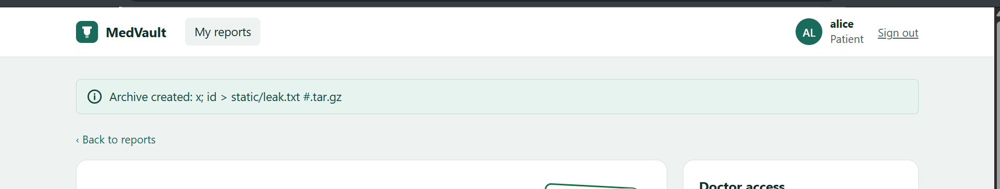

Opening `/static/leak.txt` shows the output of `id`: the command ran on the server **as root**.

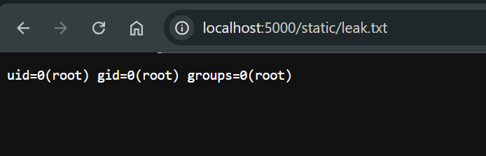

**Fix** – `app.py`

```python
ARCHIVE_NAME_RE = re.compile(r"^[A-Za-z0-9_-]{1,40}$")      # allow-list
...
if not ARCHIVE_NAME_RE.fullmatch(archive):
    abort(400, "Archive name may contain only letters, digits, - and _")
subprocess.run(["tar", "-czf", os.path.join(ARCHIVES, archive + ".tar.gz"),
                "-C", UPLOADS, report["stored_name"]],
               shell=False, check=True, timeout=15)
```

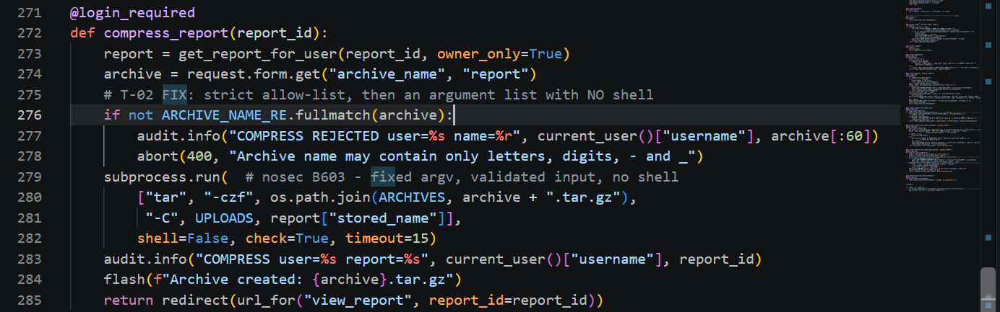

Two independent layers: (1) a strict allow-list rejects every shell metacharacter (`; | & ` $ ( )`), and (2) `tar` is started with an argument list and `shell=False`, so no shell ever interprets the input. The container also runs as an unprivileged user, so even a bypass would not be root.

**Verification** – the same payload now returns **400 Bad Request** and `leak.txt` is never created. `test_command_injection_is_rejected` passes and Bandit no longer reports B602.

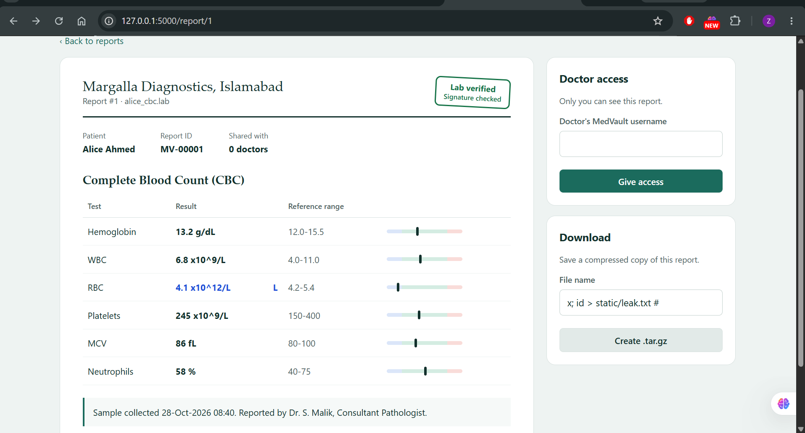
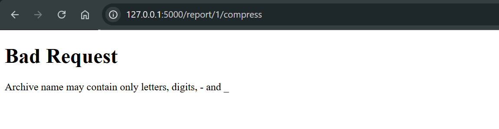

---

## 3. IDOR – Insecure Direct Object Reference (T-03, CWE-639)

**Vulnerable code** – `app.py`, `view_report()`

```python
report = db().execute("SELECT * FROM reports WHERE id = ?", (report_id,)).fetchone()
```

The report is loaded by ID only; ownership is never checked.

**Exploit (lab only)** – logged in as **alice**, change the URL from `/report/1` to `/report/2`. Bob Raza's confidential lipid profile is displayed.

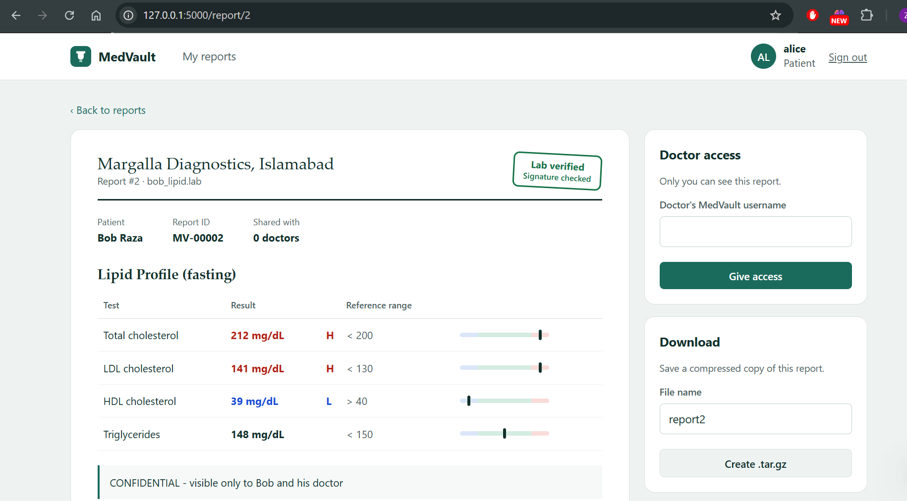

**Fix** – one central authorization function used by every report route (view, share, compress):

```python
def get_report_for_user(report_id, owner_only=False):
    user = current_user()
    report = db().execute("SELECT * FROM reports WHERE id = ?", (report_id,)).fetchone()
    if report is None or user is None:
        abort(404)
    if report["owner_id"] == user["id"]:
        return report
    if not owner_only and user["role"] == "doctor":
        shared = db().execute("SELECT 1 FROM shares WHERE report_id = ? AND doctor_id = ?",
                              (report_id, user["id"])).fetchone()
        if shared:
            return report
    audit.info("DENIED user=%s report=%s", user["username"], report_id)
    abort(404)
```

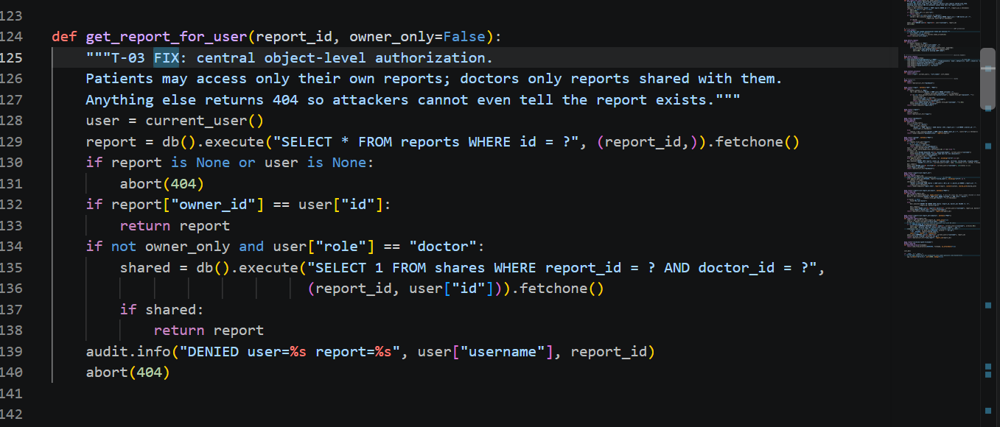
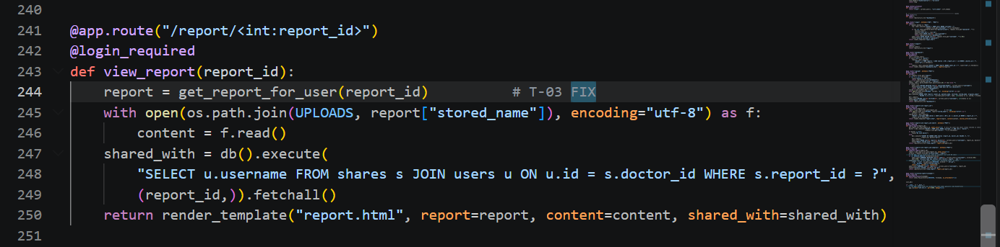

`404` is returned instead of `403` so an attacker cannot even learn which report IDs exist. Denied attempts are written to the audit log.

**Verification** – `/report/2` as alice now returns **404 Not Found**; `test_idor_other_patients_report_is_blocked` passes, and `test_owner_can_still_view_own_report` confirms legitimate access still works.

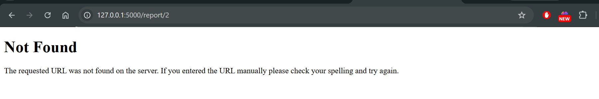

---

## 4. CSRF – Cross-Site Request Forgery (T-04, CWE-352)

**Vulnerable behaviour** – the **Give access** (share) form had no anti-CSRF token, so any website could submit it using the victim's session cookie.

**Exploit (lab only)** – while alice is logged in, she opens the attacker page `attacker/csrf.html` (served from `localhost:8000`, "You won a free health checkup"). The page silently posts `doctor=drevil` to `/report/1/share`. MedVault confirms *"Report shared with drevil"* and the attacker's doctor account can now read the report.

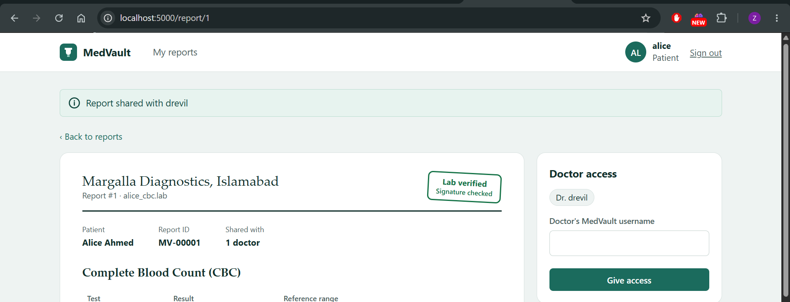

**Fix** – synchronizer token pattern plus cookie hardening:

```python
def csrf_token():                                   # one random 256-bit token per session
    if "csrf_token" not in session:
        session["csrf_token"] = secrets.token_urlsafe(32)
    return session["csrf_token"]

@app.before_request
def check_csrf():                                   # every POST must carry the token
    if request.method == "POST":
        sent = request.form.get("csrf_token", "")
        expected = session.get("csrf_token", "")
        if not expected or not hmac.compare_digest(sent, expected):
            abort(400, "Invalid or missing CSRF token")

app.config["SESSION_COOKIE_SAMESITE"] = "Strict"
app.config["SESSION_COOKIE_HTTPONLY"] = True
```

Every form contains `<input type="hidden" name="csrf_token" value="{{ csrf_token() }}">`. The comparison is constant-time (`hmac.compare_digest`).

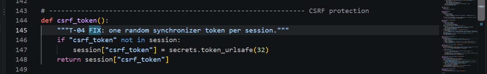
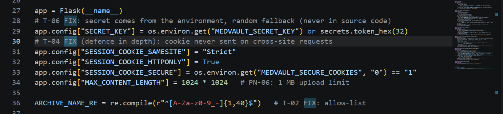

**Verification** – the same attacker page now receives **400 Bad Request – Invalid or missing CSRF token** and the share list is unchanged. `test_csrf_request_without_token_is_rejected` passes.

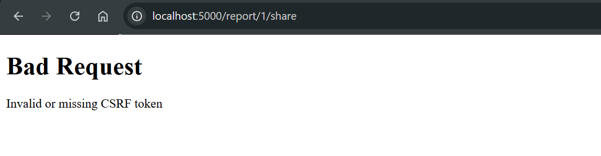

---

## 5. Clickjacking (T-05, CWE-1021)

**Vulnerable behaviour** – MedVault sent no `X-Frame-Options` or CSP `frame-ancestors` header, so any site could load it in an iframe.

**Exploit (lab only)** – `attacker/clickjack.html` loads report 1 in a transparent iframe (30 % opacity for the demo) on top of a fake "promo code" box and **CLAIM PRIZE** button. The victim types `drevil` and clicks the red button – in reality typing into MedVault's doctor field and clicking **Give access**.

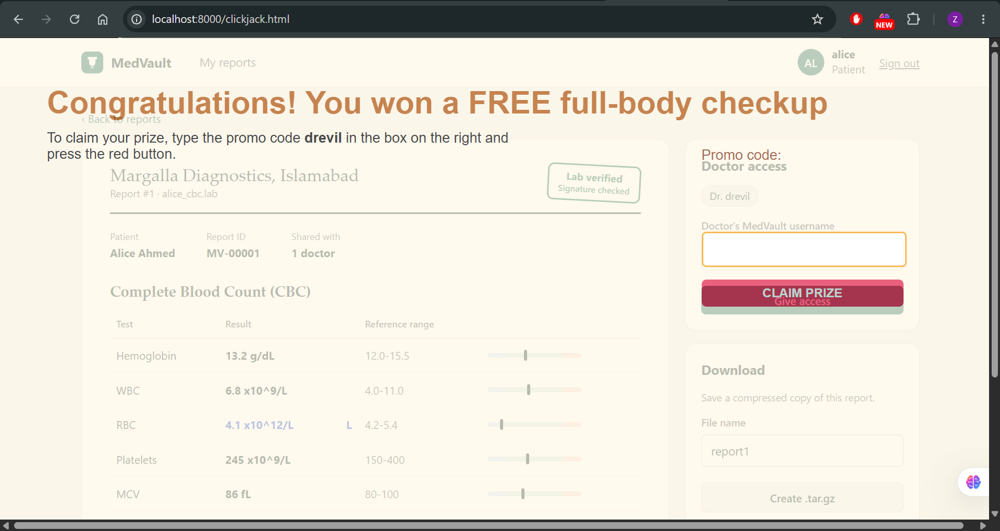
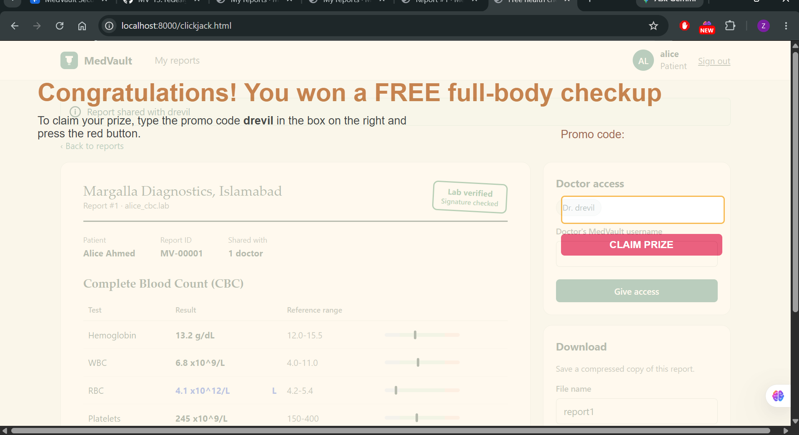

**Fix** – an `after_request` hook adds security headers to every response:

```python
resp.headers["X-Frame-Options"] = "DENY"
resp.headers["Content-Security-Policy"] = "frame-ancestors 'none'; default-src 'self'; style-src 'self' 'unsafe-inline'"
resp.headers["X-Content-Type-Options"] = "nosniff"
resp.headers["Referrer-Policy"] = "no-referrer"
resp.headers["Cache-Control"] = "no-store"
```

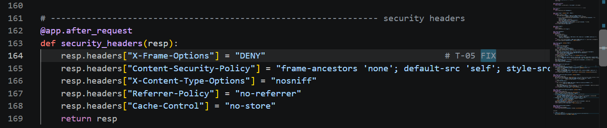

**Verification** – the browser now refuses to render MedVault inside the attacker's frame (*"localhost refused to connect"*), so there is nothing to click. `test_clickjacking_headers_present` passes.

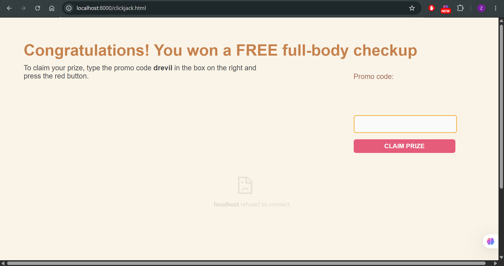

---

## 6. Additional findings fixed (found by Bandit and code review)

| ID | Finding | Evidence | Fix | CIA |
|---|---|---|---|---|
| T-06 | Hard-coded Flask `SECRET_KEY` – anyone reading the source could forge sessions | source review | Key read from `MEDVAULT_SECRET_KEY` environment variable with a random fallback | C, I |
| T-07 | `app.run(debug=True)` (Bandit **B201, High**) – Werkzeug debugger allows code execution | 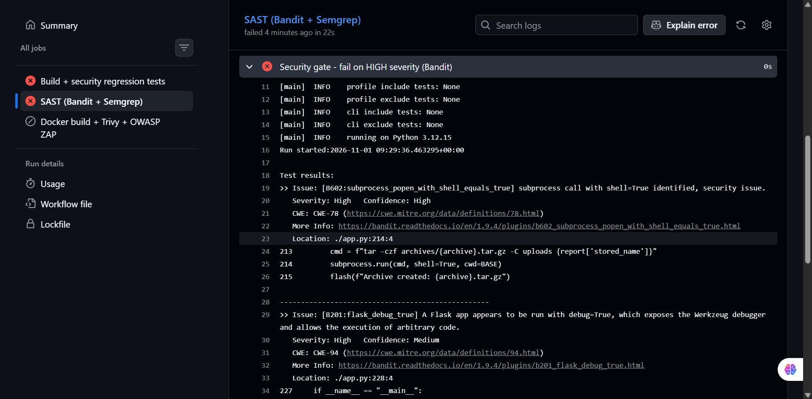 | `debug=False`; container runs gunicorn as non-root `appuser` | C, I, A |
| T-08 | No audit trail (STRIDE Repudiation) | threat model | `AUDIT` log lines for login, failed login, upload, share, compress, denied access and rejected CSRF | I |
| PN-06 | No upload size limit | threat model | `MAX_CONTENT_LENGTH = 1 MB` | A |

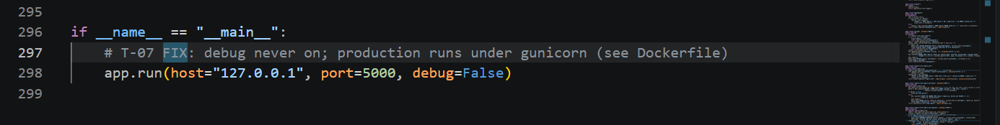

## 7. Secure coding checklist

- [x] Never trust client-supplied lengths for memory operations (parser checks every length)
- [x] Unsafe C code isolated in one small module with a clear boundary (`libparser.so`)
- [x] Compiler hardening: `-fstack-protector-strong`, `-D_FORTIFY_SOURCE=2`, full RELRO; ASAN in CI
- [x] No shell interpretation of user input; allow-list validation
- [x] Centralized authorization (`get_report_for_user`) instead of scattered checks
- [x] CSRF token on every state-changing request; `SameSite=Strict`, `HttpOnly` cookies
- [x] Anti-framing and other security headers on every response
- [x] Secrets from environment, debug off, non-root container
- [x] Parameterized SQL everywhere; Jinja auto-escaping for output
- [x] Every fix covered by an exploit-replay regression test in CI
