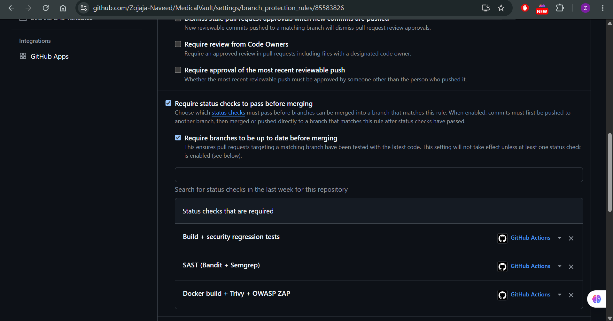
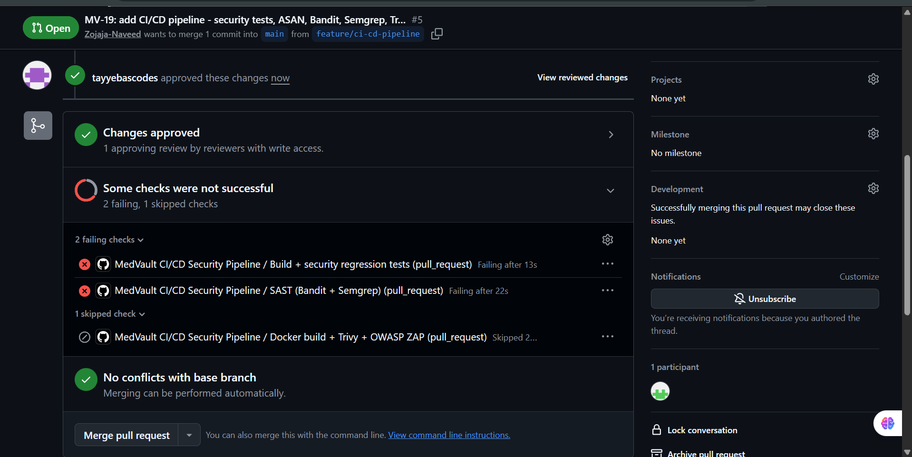
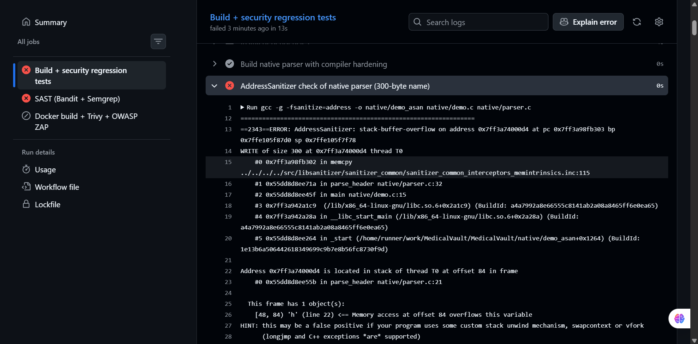
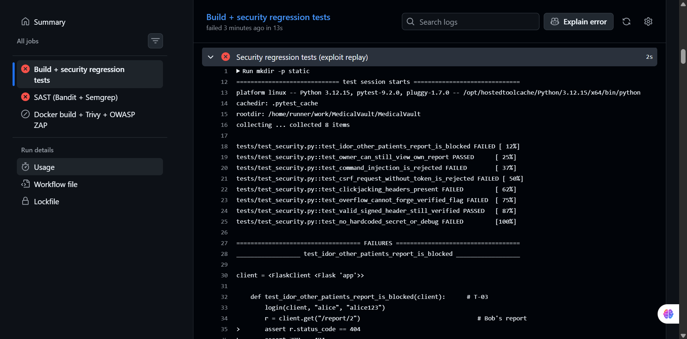
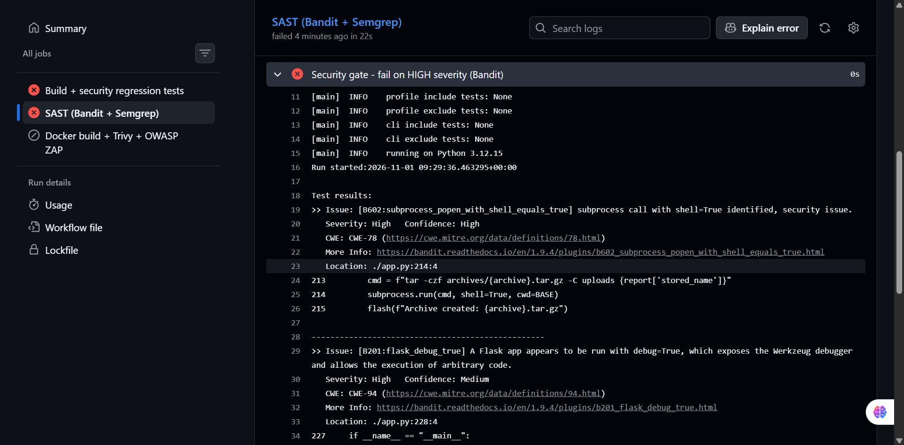
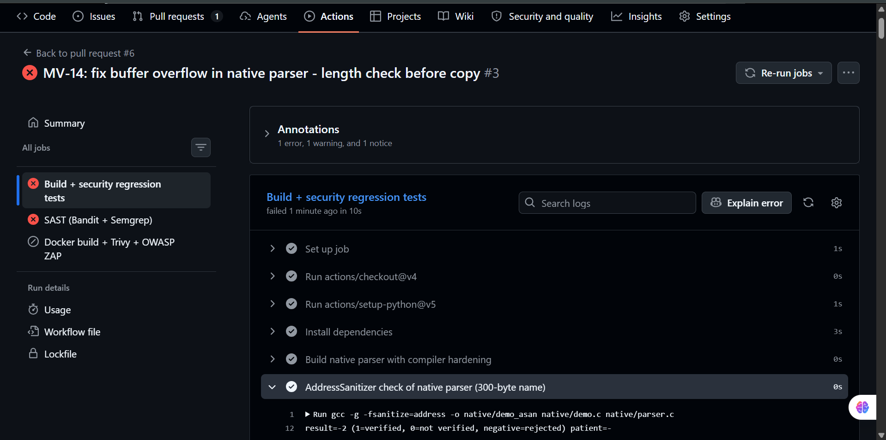
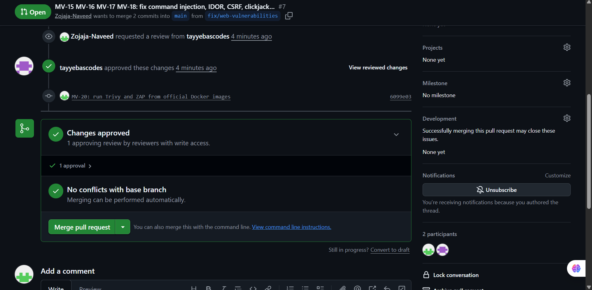

# Security Test Report – MedVault

Team **MedicalVault** · Zojaja Naveed (FA23-BCT-047) · Tayyeba Usman (FA23-BCT-053)

**Result:** the pipeline failed on the vulnerable code (6 of 8 exploit tests failed, 2 High-severity Bandit findings, AddressSanitizer stack-buffer-overflow) and passes after the fixes in PR #6 and PR #7.
Merging into `main` is blocked until all three security jobs pass.

## 1. Pipeline overview

Workflow: [`.github/workflows/ci-cd.yml`](.github/workflows/ci-cd.yml) – triggered on every `push` and `pull_request` to `main` / `develop` (plus manual `workflow_dispatch`).

| Job | Stage | Tool / configuration | Type | Gate – the build fails when… |
|---|---|---|---|---|
| Build + security regression tests | Build | gcc `-O2 -Wall -Wextra -fstack-protector-strong -D_FORTIFY_SOURCE=2 -Wl,-z,relro,-z,now` | Build | compile error |
| | Memory check | AddressSanitizer (`-fsanitize=address`) running the parser with a 300-byte name | Dynamic | any ASAN error |
| | Exploit-replay tests | pytest, `tests/test_security.py` (8 tests) → `pytest-report.xml` artifact | Integration | any exploit succeeds |
| SAST (Bandit + Semgrep) | SAST | Bandit 1.9 (`-r . -x ./tests`), full JSON report artifact | Static | any **High** severity finding (`bandit -lll`) |
| | SAST | Semgrep rulesets `p/python`, `p/flask`, JSON report artifact | Static | report only |
| Docker build + Trivy + OWASP ZAP | Container scan | Trivy (`aquasec/trivy`) `--severity CRITICAL --ignore-unfixed --exit-code 1` | Image | any fixable **Critical** CVE |
| | DAST | OWASP ZAP baseline (`ghcr.io/zaproxy/zaproxy:stable`, `zap-baseline.py`) against the running container → `zap-report` artifact | Dynamic | report only (`-I`) |

The Docker job only runs when both earlier jobs pass (`needs: [build-and-test, sast]`), so a failed security gate also blocks the image build.
Branch protection on `main` requires all three checks and one approving review:

### Exploit-replay tests

| Test | Threat | What it does |
|---|---|---|
| `test_idor_other_patients_report_is_blocked` | T-03 | alice requests `/report/2`; expects 404 and no confidential text |
| `test_owner_can_still_view_own_report` | – | alice can still open her own report (no over-blocking) |
| `test_command_injection_is_rejected` | T-02 | posts `x; id > static/pwned.txt #`; the file must not be created |
| `test_csrf_request_without_token_is_rejected` | T-04 | share request without token; expects 400 and no share |
| `test_clickjacking_headers_present` | T-05 | checks `X-Frame-Options: DENY` and `frame-ancestors 'none'` |
| `test_overflow_cannot_forge_verified_flag` | T-01 | 36-byte name with `NOT-SIGNED` must not be verified |
| `test_valid_signed_header_still_verified` | – | a genuine signed header is still accepted |
| `test_no_hardcoded_secret_or_debug` | T-06, T-07 | source contains no hard-coded secret and no `debug=True` |

## 2. Before – vulnerable code (PR [#5](https://github.com/Zojaja-Naveed/MedicalVault/pull/5), pipeline introduced)

The pipeline was merged while the vulnerable baseline was still on `main`, to prove it detects the vulnerabilities.

| Check | Result |
|---|---|
| AddressSanitizer | ❌ `stack-buffer-overflow` in `parse_header` (`native/parser.c`) – WRITE beyond the 32-byte `patient` buffer |
| Exploit-replay tests | ❌ **6 failed, 2 passed** (IDOR, command injection, CSRF, clickjacking, overflow, secret/debug) |
| Bandit gate | ❌ **B602** `subprocess_popen_with_shell_equals_true` – High/High, CWE-78, `app.py:214`; **B201** `flask_debug_true` – High/Medium, CWE-94, `app.py:228` |
| Bandit (lower severity) | Low/Medium findings listed in the `sast-reports` artifact |
| Docker + Trivy + ZAP | ⏭ skipped – blocked by the failed gates |

**Fail-on-critical proof:** both the test job and the SAST job exit non-zero, the PR shows *"Some checks were not successful"*, and the downstream Docker job is skipped.

## 3. Intermediate – buffer overflow fixed (PR [#6](https://github.com/Zojaja-Naveed/MedicalVault/pull/6))

The AddressSanitizer step turns green (`result=-2`, no memory error) and the overflow test passes. The pipeline is still red because the four web vulnerabilities remain – showing that each gate is independent.

## 4. After – all fixes (PR [#7](https://github.com/Zojaja-Naveed/MedicalVault/pull/7))

| Check | Result |
|---|---|
| AddressSanitizer | ✅ 300-byte name rejected, no memory error |
| Exploit-replay tests | ✅ **8 passed** |
| Bandit gate | ✅ no High findings (B602 and B201 removed; remaining `subprocess` use is an argument list without shell, annotated `# nosec B603`) |
| Trivy | ✅ no fixable Critical CVEs in the image |
| OWASP ZAP baseline | ✅ completed; anti-clickjacking and missing-header alerts no longer raised. Remaining informational alerts are in the `zap-report` artifact |

PR #7 was approved and became mergeable only after all required checks passed:

All workflow runs and their artifacts (`pytest-report`, `sast-reports`, `zap-report`): [https://github.com/Zojaja-Naveed/MedicalVault/actions](https://github.com/Zojaja-Naveed/MedicalVault/actions)

## 5. Before / after summary

| Threat | Before | After | Automated evidence |
|---|---|---|---|
| T-01 Buffer overflow | Forged "Lab verified"; 300 bytes crash the server | Rejected ("Invalid report header"); server stays up | ASAN step + `test_overflow_*` |
| T-02 Command injection | `id` executed as root | 400 Bad Request, no command executed | `test_command_injection_*` + Bandit B602 gone |
| T-03 IDOR | alice reads Bob's report | 404 Not Found | `test_idor_*` |
| T-04 CSRF | Attacker page shares report with drevil | 400 Invalid or missing CSRF token | `test_csrf_*` |
| T-05 Clickjacking | MedVault rendered inside attacker frame | Browser refuses to frame the page | `test_clickjacking_*` + ZAP |
| T-06 / T-07 | Hard-coded secret; debug mode on | Secret from environment; debug off, gunicorn, non-root | `test_no_hardcoded_*` + Bandit B201 gone |

Manual before/after screenshots for every class are in [SECURITY_IMPLEMENTATION.md](SECURITY_IMPLEMENTATION.md).
